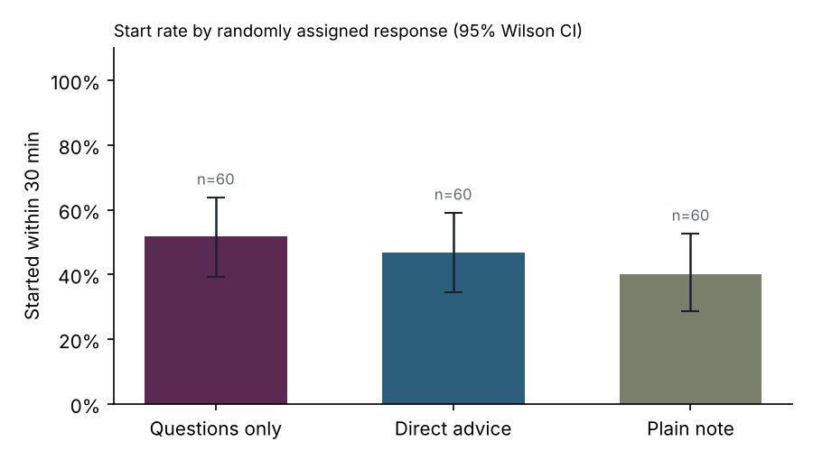
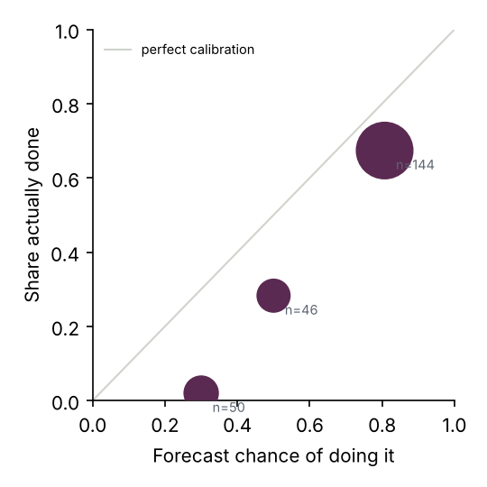

# Example output (SYNTHETIC data, not results)

Generated by `analysis/analyze.py`. Edit the interpretation, not the numbers.

## Primary outcome: started within 30 minutes

180 of 180 stuck episodes have an answered follow-up, from 6 participant(s). Episodes without an answer are excluded (see PROTOCOL.md).

| Response | Episodes | Started | Rate | 95% CI (Wilson) | Felt like my decision (1–7) | Helpful (1–7) |
| --- | --- | --- | --- | --- | --- | --- |
| Questions only | 60 | 31 | 52% | 39%–64% | 5.4 (5.1–5.7) | 4.5 |
| Direct advice | 60 | 28 | 47% | 35%–59% | 4.7 (4.4–5.0) | 4.5 |
| Plain note | 60 | 24 | 40% | 29%–53% | 5.0 (4.7–5.3) | 4.4 |

**Model.** GEE logistic model, exchangeable correlation within participant. Odds ratios relative to the plain note:

| Response | Odds ratio | 95% CI | p |
| --- | --- | --- | --- |
| Direct advice | 1.31 | 0.63–2.72 | 0.465 |
| Questions only | 1.60 | 0.85–3.01 | 0.142 |

With pilot-sized samples these intervals will be wide. Report them as estimates of effect size and uncertainty, not as tests that pass or fail.

## Dependence

In 10 of 60 Socratic episodes (17%, 95% CI 9%–28%) the person pressed "Just tell me what to do".

## Self-prediction

240 forecasts. Brier score 0.207 (0 is perfect). Baseline from always predicting the overall rate (46%): 0.249. Skill +0.17 (above 0 means the individual forecasts carry information).

| Forecast | Trials | Mean forecast | What happened |
| --- | --- | --- | --- |
| ≤30% | 50 | 30% | 2% |
| 40–60% | 46 | 50% | 28% |
| ≥70% | 144 | 81% | 67% |

